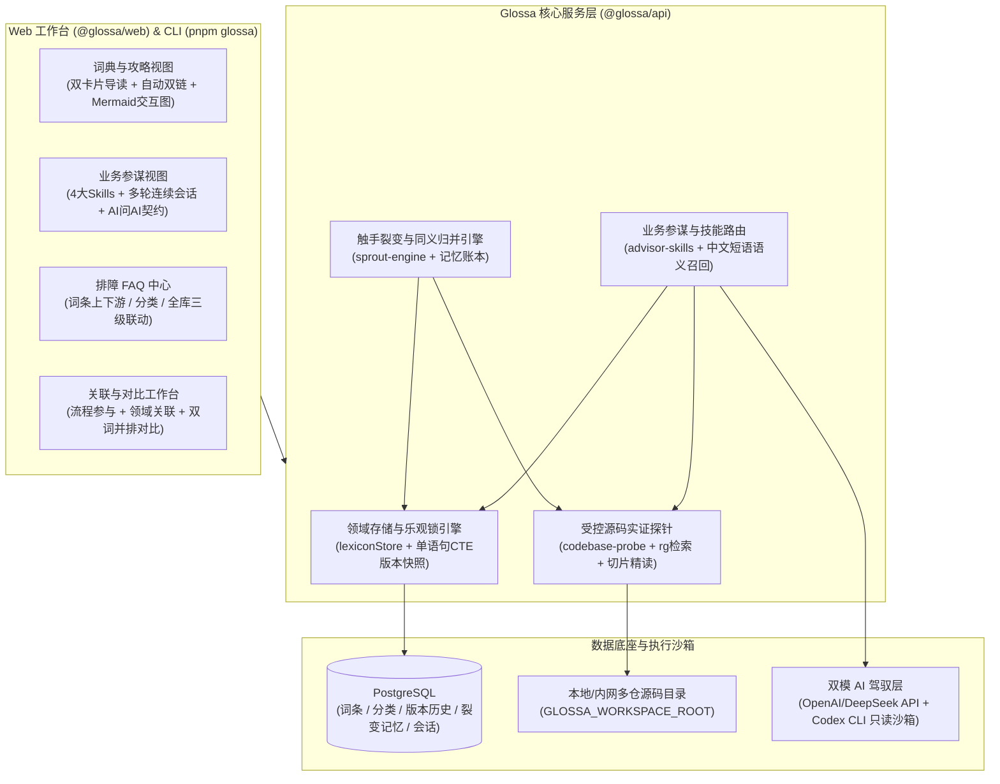

# Glossa · 产品与系统架构蓝图 (Architecture Blueprint)

> **定位**：从真实代码底座生长出来的开源领域百科、端到端流程攻略（ASOP）与 AI 业务参谋引擎。

---

## 一、第一性原理与核心设计哲学

在复杂的企业级研发与多微服务/多仓协作中，业务规则往往散落在数十个代码仓库的状态机、校验器与定时任务里：
- **传统文档容易腐化**：手写 Wiki 与真实生产代码脱节，新人、产品、运营与外部 AI Agent 无法获知系统的真实边界。
- **AI 直接答疑容易幻觉**：缺乏领域词典约束与源码切片实证时，通用大模型会把跨行业通用概念张冠李戴到当前系统中。

**Glossa** 通过三个核心闭环解决这一痛点：
1. **纯空壳引擎 + 数据库自洽（Empty-Shell Engine）**：
   - 引擎本身不包含任何特定业务项目的硬编码数据；任何团队只需将 `GLOSSA_WORKSPACE_ROOT` 指向自己的单仓或多仓代码目录、连接 PostgreSQL 数据库，即可生长出专属的领域百科。
2. **源码实证驱动的「触手裂变 (Sprout Harness)」**：
   - 从少量核心种子概念出发，自动剖析正文中的未知业务触手，执行数据库查重与 Top-5 相似词召回，自动完成「同义别名归并 (`MERGE_AS_ALIAS`)」、「独立新词生成 (`GENERATE_TERM`)」与「通用词剔除 (`REJECT`)」，并使全站双链（`.term-link`）即时生效。
3. **业务参谋与双模 Harness 驾驭（Advisor & Skills）**：
   - 提供 **现场疑难排障 (`troubleshooting`)**、**需求方案推演 (`solution-design`)**、**统计口径分析 (`metrics-analytics`)**、**术语潜台词拆解 (`jargon-demystify`)** 四大专业参谋技能，支持多轮连续追问与外部 Agent「AI 问 AI」标准接口调用。

---

## 二、系统分层架构

---

## 三、四大业务参谋技能 (Advisor Skills) 与双模驾驭

| 技能 ID | 适用场景 | 输出报告契约 |
| :--- | :--- | :--- |
| **`troubleshooting`**（现场疑难排障） | 一线反馈“看不到数据、按钮置灰、无法执行、状态卡住” | 一句话原因定性 $\rightarrow$ 页面/接口校验链路与源码实证拆解 $\rightarrow$ 1-2-3 现场核查清单 |
| **`solution-design`**（需求方案推演） | 产品/研发询问“想要支持某新能力该如何设计、影响哪些模块” | 既有词条与底座复用评估 $\rightarrow$ 配置/执行/核算三层落地方案 $\rightarrow$ 上下游波及面与防坑提醒 |
| **`metrics-analytics`**（统计口径分析） | 运营/管理层询问“某指标分子分母怎么算、异常如何剔除” | 核心计算公式与统计周期 $\rightarrow$ 异常剔除与并表边界 $\rightarrow$ 实时看板与快照核对建议 |
| **`jargon-demystify`**（术语潜台词拆解） | 粘贴包含密集内部术语的群聊记录、需求描述或业务规则 | 一句话白话总译 $\rightarrow$ 逐项术语与角色职责拆解 $\rightarrow$ 业务评审注意项 |

### 双模执行驾驭
1. **词典 + 源码探针模式（秒级交互，默认）**：
   - 自动从用户问题与多轮历史中提取领域短语 $\rightarrow$ 召回 PostgreSQL 中最相关的词条、ASOP 与库表映射 $\rightarrow$ 调用 `rg` 在 `GLOSSA_WORKSPACE_ROOT` 检索中英文锚点并精读前 4 处核心源码上下文窗口 $\rightarrow$ 注入大模型一次性合成实证报告。
2. **Codex CLI 只读沙箱深潜模式（深度考古）**：
   - 通过本机或内网 Worker 启动 `codex exec --sandbox read-only`，挂载预取的源码切片与词典证据执行深度跨仓核验。
